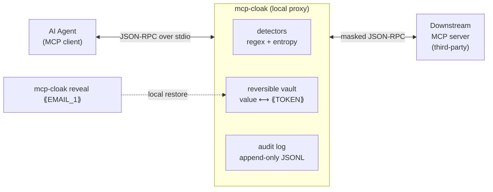

# mcp-cloak

**A local, reversible secret & PII redaction proxy for Model Context Protocol (MCP) traffic.**

mcp-cloak sits between an AI agent (the MCP client) and a downstream MCP server,
intercepting real JSON-RPC messages in both directions. It masks detected secrets
and PII with stable, **reversible** placeholder tokens (e.g. `⟪EMAIL_1⟫`), records
every mask in an append-only audit log, and lets you restore the original value
locally for debugging — so an agent never leaks a real API key or PII to a
third-party MCP server, and you never lose the ability to see what was hidden.

> Author: **Dhanush Shankar** ([danushankar3@gmail.com](mailto:danushankar3@gmail.com)) · B.Tech CSE '26 · seeking AI-security internships
> License: MIT · No paid keys, runs fully offline, zero required runtime dependencies.

---

## The threat

Agents increasingly connect to *third-party* MCP servers (CRMs, search tools,
databases, SaaS connectors). Every request an agent sends, and every response it
receives, flows through those servers and often onward into an LLM's context
window. That traffic routinely contains things it shouldn't expose:

- the agent's **own credentials** (API keys, tokens, private keys) sent to a tool,
- **customer PII** (emails, phone numbers) returned by a tool and then forwarded
  to a hosted model,
- **internal infrastructure** details (private IPs, internal hostnames).

Once a raw secret crosses into a third-party server or a model provider's logs,
it is effectively leaked. You cannot un-send it.

## Architecture



- **Outbound** (agent → downstream): secrets in the agent's requests are masked so
  the third-party server sees `⟪APIKEY_1⟫`, never the real key.
- **Inbound** (downstream → agent): PII in the server's responses is masked so the
  agent's LLM context sees `⟪EMAIL_1⟫`, never the real address. Placeholders the
  agent itself sent are restored on the way back (round-trip correctness).
- **Reveal**: because the mapping lives *locally* in the vault, you can run
  `mcp-cloak reveal ⟪EMAIL_1⟫` to recover the original value while debugging.

## Where it fits (the reversible wedge)

MCP security tooling today splits into two camps:

| Tool | Type | Reversible? | For whom |
| --- | --- | --- | --- |
| [lasso `mcp-gateway`](https://github.com/lasso-security/mcp-gateway) (377★) | Enterprise **one-way** gateway | No — strips/blocks | Enterprises |
| [invariant `mcp-scan`](https://github.com/invariantlabs-ai/mcp-scan) (2.7k★) | **Scanner** | N/A — detects, doesn't redact | Security teams |
| **mcp-cloak** | Local **redaction proxy** | **Yes — placeholder tokens** | **Solo devs** |

One-way gateways destroy the data (great for compliance, painful for debugging).
Scanners tell you a leak *happened* but don't stop it inline. A simple, local,
open-source, **reversible** redaction proxy — where the real value stays on your
machine and can be restored locally — has previously existed only as abandoned
single-digit-star experiments. **Reversibility is the wedge.**

## Quickstart

Requires Python **3.11+** (for stdlib `tomllib`).

```bash
git clone https://github.com/Danush-Aries/mcp-cloak
cd mcp-cloak
python -m venv .venv && source .venv/bin/activate

# Install with the dev extra to run the tests:
pip install -e ".[dev]"

# Run the full test suite:
pytest
```

### Run the end-to-end example

The example ships a real mock "CRM" MCP server that returns a record seeded with
*obviously fake* secrets/PII, and a scripted client that drives the whole
pipeline through the real proxy:

```bash
python examples/demo_client.py
```

You will see (1) the client receiving `⟪...⟫` placeholders instead of raw
secrets, (2) the audit log recording each mask, and (3) `reveal` restoring the
originals locally.

You can also wrap any MCP server manually:

```bash
mcp-cloak wrap -- python examples/mock_crm_server.py
# ...or any real server:
mcp-cloak wrap -- npx -y @modelcontextprotocol/server-filesystem /some/path
```

### Inspect and reveal

```bash
mcp-cloak audit                 # human-readable audit log
mcp-cloak audit --tail 5 --json # last 5 entries as JSON
mcp-cloak reveal ⟪EMAIL_1⟫      # -> alice@example.com  (local only)
```

## What it detects

Regex + Shannon-entropy detectors (all pure stdlib, no external services):

- **Credentials**: provider-prefixed API keys (`sk-…`, `ghp_…`, `xoxb-…`, `AIza…`),
  AWS access-key IDs (`AKIA…`), JWTs, PEM private-key blocks, and generic
  high-entropy secrets.
- **PII**: email addresses, phone numbers.
- **Infrastructure**: RFC1918 private IPs, internal hostnames (`*.internal`,
  `*.corp`, `*.local`, …).

An optional **Microsoft Presidio** backend can be enabled for richer PII
(`pip install -e ".[presidio]"`, then `use_presidio = true` in config). The
regex path is fully functional without it.

## Configuration (`cloak.toml`)

mcp-cloak runs with sensible defaults and needs no config file. To customize,
drop a `cloak.toml` in your working directory (see the shipped example):

```toml
[cloak]
mask_outbound = true       # mask client -> downstream
mask_inbound = true        # mask downstream -> client
restore_returning = true   # restore returning placeholders to the client
entropy_enabled = true
entropy_threshold = 3.5
use_presidio = false

[detectors]
phone = false              # toggle any detector class off

# Allow/deny rules matched against (tool, field).
[[rules]]
tool = "crm.get_customer"
field = "notes"
action = "allow"           # leave this field un-masked
```

## Audit log format

Append-only JSONL, one masking event per line. It records the class and
placeholder — **never** the raw secret:

```json
{"ts":"2026-07-02T10:11:12.001+00:00","direction":"from_downstream","tool":null,"method":null,"rpc_id":2,"class":"EMAIL","placeholder":"⟪EMAIL_1⟫","value_len":17}
```

Fields: `ts` (ISO-8601 UTC), `direction`, `tool`, `method`, `rpc_id`, `class`,
`placeholder`, `value_len`.

## How reversibility works

The vault keeps a deterministic, bidirectional map `real value ⟷ ⟪CLASS_N⟫`. The
same value always maps to the same token within a session, and masking guarantees
`restore(mask(x)) == x` (verified by a property test over 1000+ randomized inputs
plus Hypothesis). The map is persisted to `./.mcp-cloak/vault.json` so the
separate `reveal` process can restore values.

## Honest limitations

- **The vault file contains real values.** Local restore is only possible because
  the `real ⟷ token` map is stored on disk (`./.mcp-cloak/vault.json`). That file
  is the reversibility trade-off: protect it like any secret store. It is
  `.gitignore`d by default. If you need one-way redaction, disable persistence /
  use an enterprise gateway instead.
- **Detection is best-effort.** Regex + entropy catch common secret/PII shapes but
  will miss novel formats and can occasionally over- or under-match free text.
  Presidio helps for PII but is not a guarantee. This is a defense-in-depth layer,
  not a proof.
- **stdio transport** is fully supported. SSE/HTTP transports are out of scope for
  this version (the framing layer is isolated in `mcp_cloak/jsonrpc.py` to make
  that a natural extension).
- **No semantic understanding.** mcp-cloak masks values, not intent; it will not
  stop an agent from *describing* a secret in prose.

## Project layout

```
mcp_cloak/
  detectors.py   regex + entropy secret/PII detection
  vault.py       reversible value <-> placeholder map (+ persistence)
  audit.py       append-only JSONL audit log
  config.py      TOML config + allow/deny rules
  jsonrpc.py     newline-delimited JSON-RPC framing
  proxy.py       bidirectional stdio passthrough + masking
  cli.py         `wrap`, `audit`, `reveal`
examples/
  mock_crm_server.py   real MCP-style server seeded with fake secrets
  demo_client.py       end-to-end demo driver
tests/                 pytest suite (detectors, round-trip property, leak
                       canary, framing, audit, config/rules, e2e)
```

## License

MIT © 2026 Dhanush Shankar
